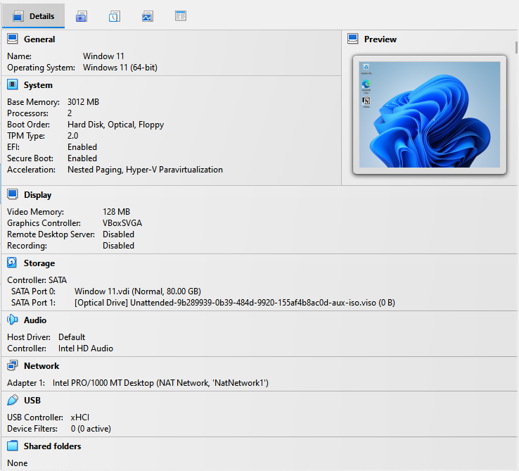
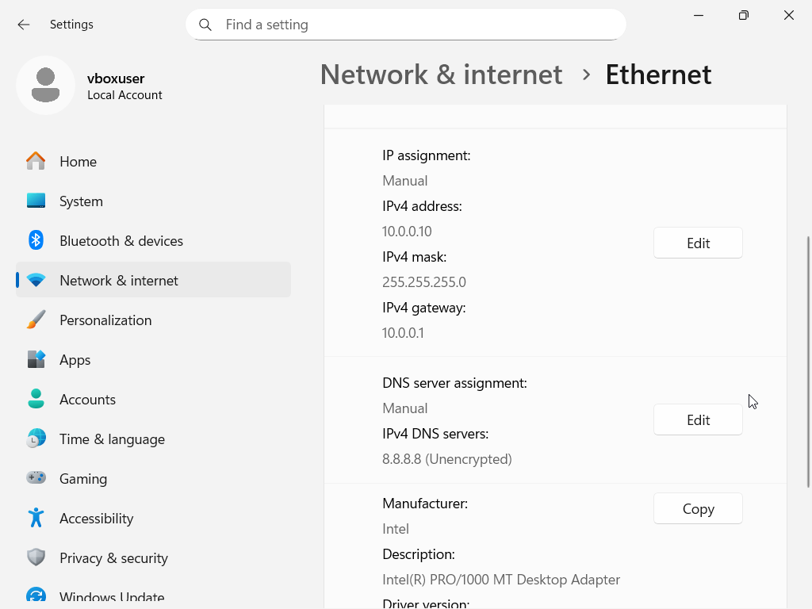
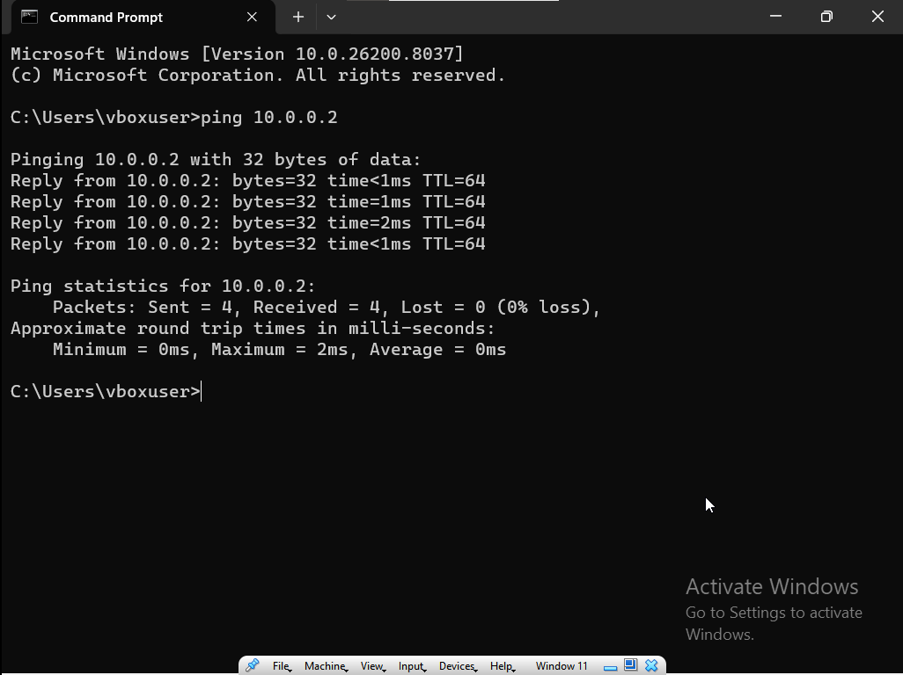
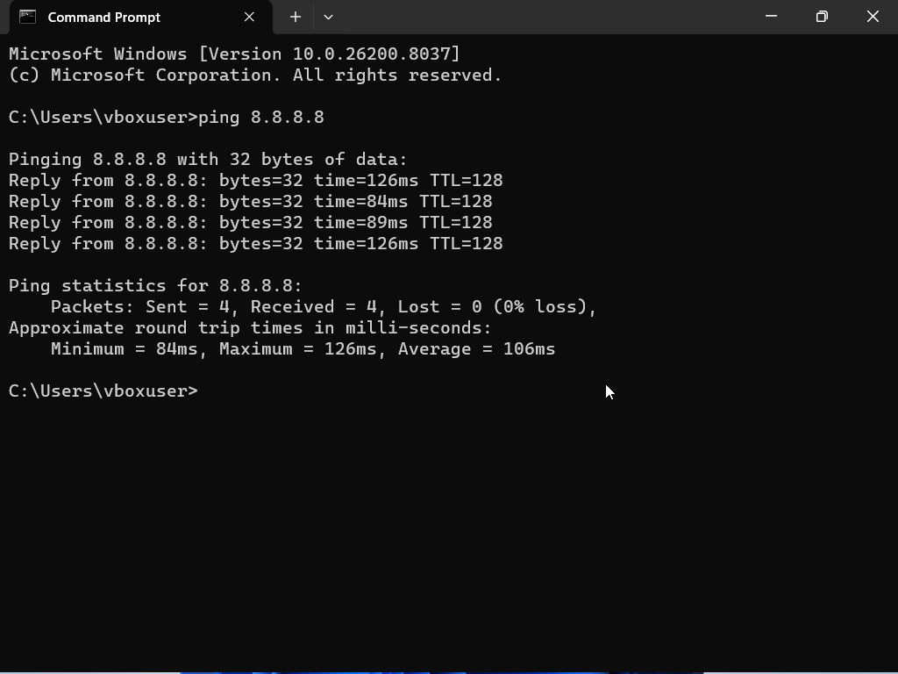
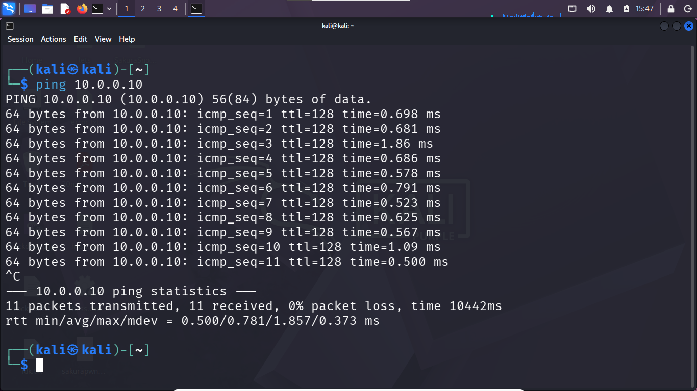

# Networkwalks Week 1: Windows 11 VirtualBox Lab

**Author:** Faisol Daud  
**Program:** Networkwalks Cybersecurity Program · Batch B084  
**Project:** Week 1 Extra Project

## Overview

I created a Windows 11 virtual machine in Oracle VirtualBox and connected it to the same NAT Network as my Kali Linux and Android-x86 virtual machines. I configured a static IPv4 address for Windows and tested connectivity between Windows and Kali, as well as outbound internet connectivity.

This lab demonstrates virtual machine setup, basic IPv4 configuration, and connectivity verification in a controlled environment.

## Lab configuration

| Component | Configuration |
|---|---|
| Hypervisor | Oracle VirtualBox |
| Windows guest | Windows 11 |
| Kali Linux guest | Kali Linux · `10.0.0.2/24` |
| Android guest | Android-x86 9.0 · `10.0.0.9/24` |
| Windows IPv4 address | `10.0.0.10/24` |
| Network | VirtualBox NAT Network |
| Default gateway | `10.0.0.1` |
| DNS server | `8.8.8.8` |

The three virtual machines are connected to the same VirtualBox NAT Network. This shared network allows the guests to communicate with one another while using the configured NAT gateway for external connectivity.

## Network topology

```text
                       Internet
                          |
                VirtualBox NAT Network
                    10.0.0.0/24
                   /      |      \
                  /       |       \
           Kali Linux  Android-x86  Windows 11
            10.0.0.2    10.0.0.9    10.0.0.10
```

## Setup workflow

1. Download the Windows installation ISO from Microsoft's official source.
2. Create a new Windows 11 virtual machine in Oracle VirtualBox.
3. Allocate suitable memory and virtual disk space for the guest operating system.
4. Attach the Windows ISO and complete the Windows installation.
5. Connect the Windows VM's network adapter to the same NAT Network used by Kali Linux and Android-x86.
6. Configure Windows IPv4 settings with the address `10.0.0.10`, subnet mask `255.255.255.0`, gateway `10.0.0.1`, and DNS server `8.8.8.8`.
7. Test connectivity from Windows to Kali, then test the reverse direction from Kali to Windows.
8. Check outbound connectivity from Windows.

## Connectivity verification

I used the following tests to check network reachability.

### From Windows 11

Open Command Prompt and run:

```bat
ping 10.0.0.2
ping 8.8.8.8
```

- `ping 10.0.0.2` checks connectivity from Windows to Kali Linux.
- `ping 8.8.8.8` checks outbound IP connectivity.

### From Kali Linux

Run:

```bash
ping -c 4 10.0.0.10
```

This checks connectivity from Kali Linux to Windows 11.

A successful ping indicates that ICMP traffic reached the destination and received a response. A failed ping alone does not necessarily prove that a host or the internet is unreachable, because ICMP traffic may be filtered.

## Evidence screenshots

The screenshots below document the Windows VM, its network settings, and the connectivity tests.

### Windows 11 VM in VirtualBox



### Windows network settings



### Windows-to-Kali connectivity



### Windows outbound connectivity



### Kali-to-Windows connectivity



## Key takeaways

Through this project, I practised how to:

- Install and configure a Windows virtual machine in VirtualBox.
- Connect multiple guest operating systems to a shared NAT Network.
- Configure static IPv4 addressing, a subnet mask, a default gateway, and DNS.
- Test connectivity between virtual machines in both directions.
- Distinguish basic IP reachability checks from DNS-resolution tests.

## Scope and responsible use

This project documents virtual machine setup and network connectivity verification. It does not claim a completed penetration test or security assessment. Any future testing will be limited to systems I own or have explicit permission to assess.

## References

- [Microsoft Windows 11 download](https://www.microsoft.com/software-download/windows11)
- [Oracle VirtualBox](https://www.virtualbox.org/)
- [Kali Linux](https://www.kali.org/get-kali/)
- [Android-x86](https://www.android-x86.org/)
- [Networkwalks](https://www.networkwalks.com/)

## Acknowledgements

I would like to thank **Sir Waqas Karim (CCIE)** and the **Networkwalks** team for their guidance and support during the cybersecurity program.

*Networkwalks Cybersecurity Program · Batch B082*
